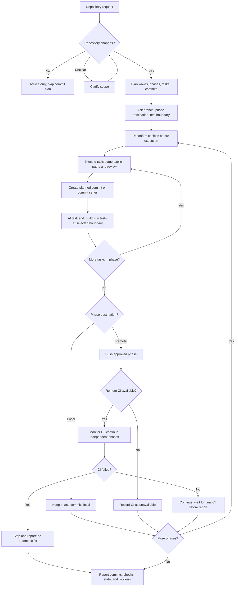

# Commit Workflow

Apply this skill automatically to repository implementation plans and work that changes repository files. If it is unclear whether a request includes repository changes, ask before creating a commit plan. Keep advice-only plans free of invented commits.

## Workflow at a glance

## Plan repository work

- Organize substantial work as **Wave → Phase → Task → Commit**. Omit empty levels for small work.
- Make each task one reviewable outcome. Default to one commit per task; split a large task into a short, ordered commit series when each step remains understandable. Keep unrelated work separate, but do not create sentence-level commits.
- For each phase, state its tasks, ordered commit messages and scope, checks, dependencies, and completion criteria. Follow the repository's commit convention; use Conventional Commits when established.
- Ask which branch to use and whether each phase's commits stay local or go to the remote. Ask how tests should be placed: within tasks, at phase boundaries, or in a dedicated test phase. Recommend based on scope: unit tests with behavior tasks, integration/regression tests after related phase work, and a dedicated acceptance-test phase for broad changes. Use the hybrid as the default proposal, not as an unapproved decision.
- Include no push or PR unless the user selects a remote destination or asks for it explicitly.
- For a direct implementation request without a written plan, prepare a concise task/commit breakdown first, then follow the same branch, destination, and test-boundary questions before editing.

## Execute an approved plan

- Before changing files, confirm the branch and each phase's local/remote destination again. Use the user's answers for this execution; ask again if scope or branch changes.
- Execute tasks in order and create their planned commits as work completes. A task may contain multiple ordered commits. Intermediate commits may not build; run the required build at the task's final commit. Run tests at the user-approved task, phase, or dedicated test-phase boundary.
- Before each commit, inspect branch, working tree, and index. Preserve pre-existing changes; do not stash, reset, clean, or overwrite them. Stage explicit paths only, inspect the staged diff, run `git diff --cached --check`, and confirm it covers only the planned commit. After committing, inspect the commit's files and summary. Do not amend, squash, or rewrite history unless requested.
- Push only phases approved for remote, to the confirmed branch, after that phase's planned checks. Never force-push. If remote CI exists, monitor it while continuing other phases and verify whether it covers the changed code. If CI fails, stop further work and report the failing run; do not create a fix or push follow-up without instruction. Report when CI is unavailable or cannot be inspected. Do not create a PR or merge unless asked.

## Report completion

List commits by phase/task with hashes and messages, checks and test boundaries completed, local/remote status, CI result, and remaining blockers. Do not describe a phase as complete until its selected checks have passed.
