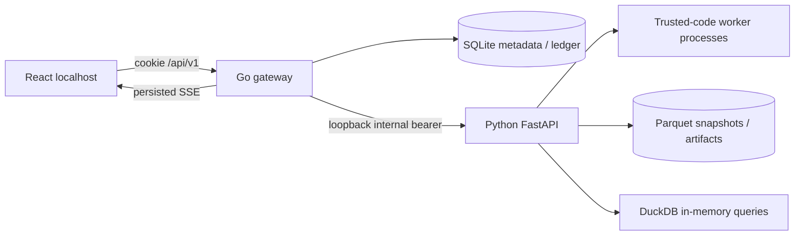

# System architecture

**Tóm tắt:** Go sở hữu API, jobs và sổ cái SQLite; Python xử lý dữ liệu, phân tích và worker. Hai dịch vụ chỉ giao tiếp qua loopback có xác thực.

Implemented fixture topology; no enabled SSI upstream transport.

Docker Compose packages the Go gateway and Python engine in one Linux container while keeping them as separate supervised processes. The browser-facing port is published only on host loopback. The host-selected `KESTREL_DATA_DIR` bind mount supplies `/data`; stopping the container preserves it. The optional development override runs Vite in a separate container and publishes both Vite and gateway only on host loopback. A three-terminal local debug mode can run Python, Go and Vite as separate host processes against the same `.env` and data directory; do not run it alongside Compose.

Go owns auth, workspace/code snapshots, jobs/events/artifact registry and finance transactions. Python never writes Go SQLite. Manual fills/cursor commit atomically; Strategy events commit individually and require inspection after interruption. No inferred missing fills.

Parquet publication uses temporary directories/checksums/completed manifests. DuckDB is per-query, not a shared writable process database. Offline backup snapshots SQLite through VACUUM INTO and checksums managed files.

Native Windows uses Job Objects; the Linux Compose runtime uses Unix process groups and container init/shutdown handling for descendants. Host/Origin/internal auth defend service boundaries, not a sandbox against the host/container user. [Security](../11-engineering/security-privacy.md).

## Python engine package layout

`services/engine/kestrel_engine/` groups implementation by responsibility:

- `api/`: request models, shared route dependencies, and HTTP route groups. `app.py` creates services and assembles the routers.
- `providers/`: common provider contracts and capability metadata, individual adapter families, and routing policy.
- `market_data/`: market snapshots, normalized provider datasets, source gates, revisions, archive, and quarantine.
- `analytics/`: causal Quant calculations.
- `execution/`: order rules, event reconciliation, and detailed replay tapes.
- `backtesting/`, `strategies/`, and `paper/`: distinct historical replay, strategy, and paper execution workflows.
- `runtime/`: job supervision, worker implementation, and process lifecycle management.

`models.py` remains the shared data-contract module. `__main__.py` starts the engine service, and the top-level `worker.py` remains the stable module entry point used to launch supervised workers.
