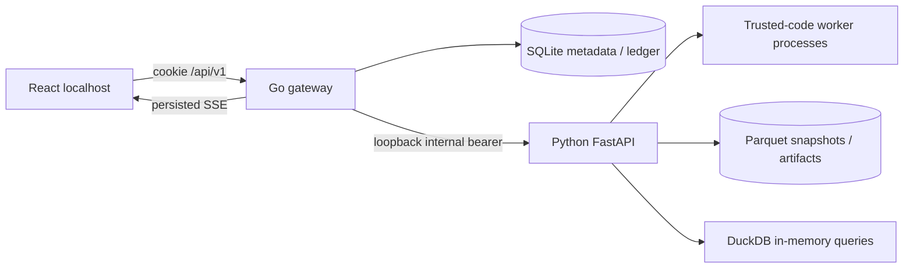

# System architecture

**Tóm tắt:** Go sở hữu API, jobs và sổ cái SQLite; Python xử lý dữ liệu, phân tích và worker. Hai dịch vụ chỉ giao tiếp qua loopback có xác thực.

Implemented fixture topology; no enabled SSI upstream transport.

Go owns auth, workspace/code snapshots, jobs/events/artifact registry and finance transactions. Python never writes Go SQLite. Manual fills/cursor commit atomically; Strategy events commit individually and require inspection after interruption. No inferred missing fills.

Parquet publication uses temporary directories/checksums/completed manifests. DuckDB is per-query, not a shared writable process database. Offline backup snapshots SQLite through VACUUM INTO and checksums managed files.

Windows Job Objects own engine/worker descendants. Host/Origin/internal auth defend service boundaries, not a sandbox against the Windows user. [Security](../11-engineering/security-privacy.md).
