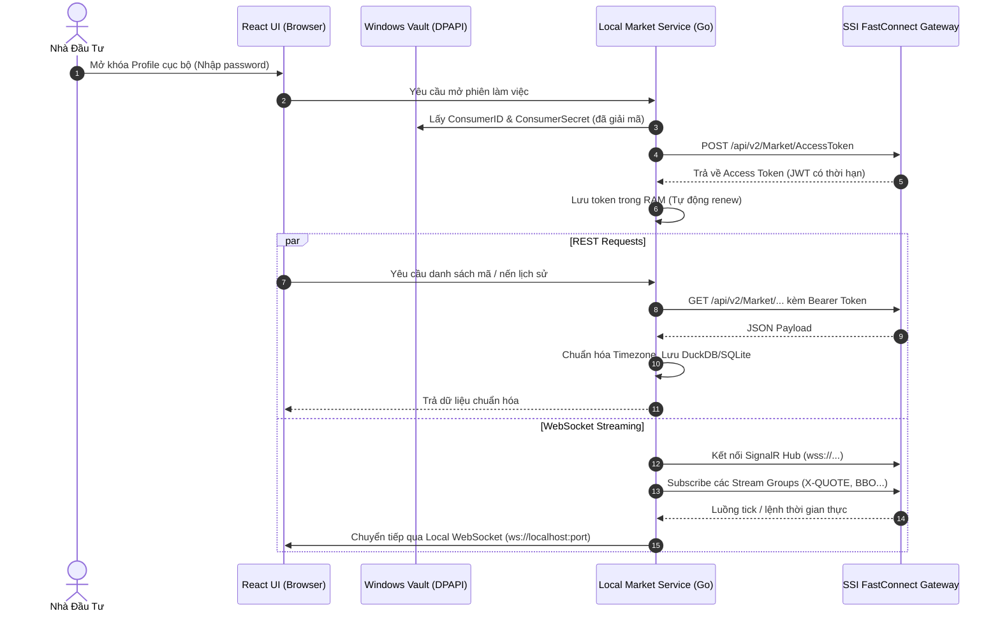

# SSI FastConnect Data — Adapter Technical Contract

**Trạng thái:** Đặc tả kỹ thuật chính thức (Technical Contract) cho module kết nối dữ liệu thị trường chứng khoán Việt Nam của **Research Terminal**.

Tài liệu này định nghĩa chi tiết cách thức ứng dụng giao tiếp với hệ thống **SSI FastConnect Data (FC Data)** thông qua cặp khóa truy cập cá nhân của người dùng (`ConsumerID` và `ConsumerSecret`).

---

## 1. Tổng Quan Kiến Trúc Kết Nối (Connection Overview)



---

## 2. Quản Lý Access Token (Authentication Lifecycle)

### 2.1. Lấy Access Token
- **Endpoint:** `POST https://fc-data.ssi.com.vn/api/v2/Market/AccessToken`
- **Headers:** `Content-Type: application/json`
- **Request Body:**
  ```json
  {
    "consumerID": "<USER_CONSUMER_ID>",
    "consumerSecret": "<USER_CONSUMER_SECRET>"
  }
  ```
- **Response Format (Thành công):**
  ```json
  {
    "status": 200,
    "message": "Success",
    "data": {
      "accessToken": "eyJhbGciOiJIUzI1NiIsIn...",
      "twoFactorType": 0,
      "expiresIn": 7200
    }
  }
  ```
- **Xử lý thực tế:**
  - Token có thời hạn mặc định là `7200` giây (2 giờ).
  - Local Market Service duy trì một bộ đếm giờ (Timer) để tự động làm mới (refresh) token trước khi hết hạn 5 phút.
  - Tuyệt đối không gửi token về trình duyệt; trình duyệt chỉ giao tiếp với local service qua loopback endpoint nội bộ.

---

## 3. Đặc Tả 9 REST Endpoints (Reference & Historical Data)

Mọi request đều bắt buộc có Header:
`Authorization: Bearer <accessToken>`

### 3.1. Danh Sách Chứng Khoán (`Securities`)
- **Endpoint:** `GET /api/v2/Market/Securities?market={market}&pageIndex={pageIndex}&pageSize={pageSize}`
- **Tham số:**
  - `market`: Mã sàn giao dịch (`HOSE`, `HNX`, `UPCOM`, hoặc để trống để lấy tất cả).
  - `pageIndex`, `pageSize`: Phân trang dữ liệu.
- **Dữ liệu chuẩn hóa:** `Symbol`, `Market`, `StockName`, `StockEnName`, `SecType` (Cổ phiếu, Phái sinh, Chứng quyền).

### 3.2. Chi Tiết Chứng Khoán (`SecuritiesDetails`)
- **Endpoint:** `GET /api/v2/Market/SecuritiesDetails?market={market}&symbol={symbol}&pageIndex={pageIndex}&pageSize={pageSize}`
- **Ý nghĩa:** Cung cấp thông tin giá trần (`CeilingPrice`), giá sàn (`FloorPrice`), giá tham chiếu (`RefPrice`), bước giá, và tỷ lệ ký quỹ ban đầu.

### 3.3. Danh Mục Chỉ Số (`IndexList`)
- **Endpoint:** `GET /api/v2/Market/IndexList?exchange={exchange}&pageIndex={pageIndex}&pageSize={pageSize}`
- **Dữ liệu:** Các chỉ số thị trường chính: `VNINDEX`, `VN30`, `HNXIndex`, `HNX30`, `UpcomIndex`.

### 3.4. Thành Phần Chỉ Số (`IndexComponents`)
- **Endpoint:** `GET /api/v2/Market/IndexComponents?indexCode={indexCode}&pageIndex={pageIndex}&pageSize={pageSize}`
- **Ý nghĩa:** Trả về danh sách cổ phiếu thành phần và tỷ trọng (ví dụ 30 cổ phiếu thuộc rổ VN30). Phục vụ việc tính toán độ lan tỏa dòng tiền và phân tích cấu trúc chỉ số.

### 3.5. Nến Lịch Sử Theo Ngày (`DailyOHLC`)
- **Endpoint:** `GET /api/v2/Market/DailyOHLC?symbol={symbol}&fromDate={dd/MM/yyyy}&toDate={dd/MM/yyyy}&pageIndex={pageIndex}&pageSize={pageSize}&ascending={bool}`
- **Response Data:**
  - `TradingDate`: Ngày giao dịch (`dd/MM/yyyy`).
  - `Open`, `High`, `Low`, `Close`: Giá mở, cao, thấp, đóng (đơn vị: nghìn VNĐ, ví dụ `24.5` = 24,500 VNĐ).
  - `Volume`: Tổng khối lượng khớp lệnh.
  - `Value`: Tổng giá trị giao dịch.

### 3.6. Nến Lịch Sử Trong Ngày (`IntradayOHLC`)
- **Endpoint:** `GET /api/v2/Market/IntradayOHLC?symbol={symbol}&fromDate={dd/MM/yyyy}&toDate={dd/MM/yyyy}&pageIndex={pageIndex}&pageSize={pageSize}&ascending={bool}&resolution={res}`
- **Tham số resolution:** `1` (1 phút), `5` (5 phút), `15` (15 phút), `30` (30 phút), `60` (1 giờ).
- **Quy tắc chuẩn hóa:**
  - Chuyển đổi timestamp cục bộ giờ Việt Nam (`Asia/Ho_Chi_Minh`) sang `timestamp_utc_ms`.
  - Kiểm tra tính đầy đủ của nến; đánh dấu trạng thái phiên (`ATO`, `CONTINUOUS`, `ATC`).

### 3.7. Dữ Liệu Khối Ngoại Mua Bán (`ForeignFlow`)
- Lấy thông tin tổng khối lượng và giá trị mua/bán của nhà đầu tư nước ngoài cho từng mã và toàn thị trường.

---

## 4. Đặc Tả 6 Stream Groups (SignalR / WebSocket Streaming)

SSI FastConnect Data sử dụng giao thức **SignalR Hub** (hoạt động trên nền WebSocket):
- **Streaming URL:** `wss://fc-data.ssi.com.vn/v2.0/signalr`

### 4.1. Danh Sách Stream Groups
1. `X-QUOTE:{market}`: Luồng giá khớp lệnh thời gian thực và thông tin bước giá khớp (Ví dụ: `X-QUOTE:HOSE`).
2. `BBO:{market}`: Luồng 3 mức giá mua tốt nhất (Best Bid) và 3 mức giá bán tốt nhất (Best Offer) kèm khối lượng tương ứng.
3. `ORDERBOOK:{symbol}`: Sổ lệnh độ sâu chi tiết của từng mã cổ phiếu cụ thể.
4. `TICK:{symbol}`: Luồng từng giao dịch đơn lẻ (Time and Sales) gồm thời gian, mức giá, khối lượng và bên chủ động (Chủ động Mua hay Chủ động Bán).
5. `INDEX:{exchange}`: Biến động điểm số của các chỉ số chính (VN-Index, VN30...).
6. `FOREIGN:{market}`: Dòng tiền khối ngoại mua ròng / bán ròng theo thời gian thực trong phiên.

### 4.2. Quản Lý Kết Nối & Tự Động Kết Nối Lại (Reconnection Policy)
- **Heartbeat & Keep-Alive:** Gửi ping định kỳ 15 giây. Nếu quá 45 giây không nhận được phản hồi từ SSI Hub, local service chủ động ngắt và kích hoạt quy trình tái kết nối.
- **Exponential Backoff:** Khoảng thời gian thử lại kết nối: 1s, 2s, 4s, 8s, tối đa 30s kèm random jitter.
- **Backfill After Disconnect:** Khi kết nối WebSocket bị gián đoạn, ngay khi kết nối lại thành công, local service tự động gọi REST API `IntradayOHLC` để lấp đầy (backfill) các nến bị khuyết trong khoảng thời gian mất mạng trước khi tiếp tục đẩy stream lên UI.

---

## 5. Dữ Liệu Giả Lập Cho Chế Độ Offline (Synthetic Fixture Mode)

Khi chưa có kết nối thật đến SSI (`approved=false` hoặc khi người dùng chưa nhập tài khoản), hệ thống chuyển sang chế độ **Offline Fixtures**:
- Nạp dữ liệu từ thư mục `data/fixtures/ssi/`.
- Phát lại nến và luồng tick theo tốc độ thực hoặc tăng tốc (Replay engine) để phục vụ phát triển giao diện và kiểm thử tính đúng đắn của thuật toán.
- Giao diện người dùng luôn hiển thị nhãn: `DATA SOURCE: SYNTHETIC FIXTURE (OFFLINE)`.
