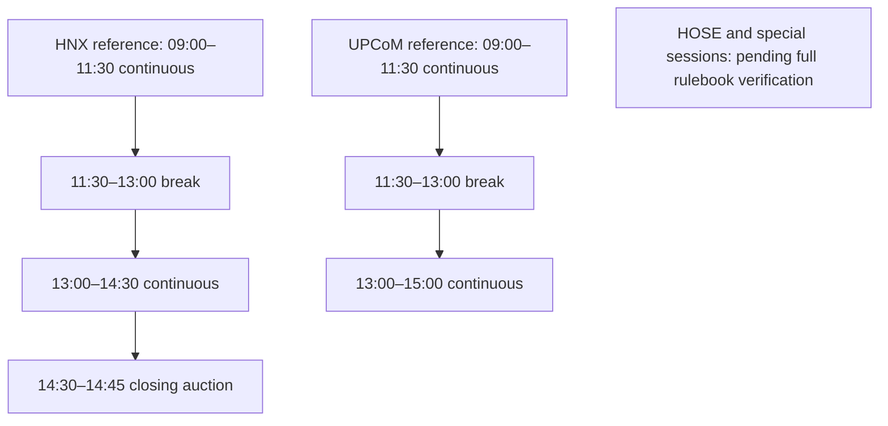
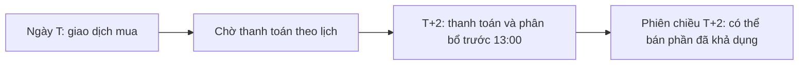

# Quy tắc thị trường Việt Nam — evidence và simulator requirements

**Review date:** 2026-10-19. Đây là bản nghiên cứu có trạng thái theo từng quy tắc, chưa phải bộ quy tắc simulator đã triển khai. Instrument coverage của V1 vẫn cần chốt theo entitlement. Không áp dụng một quy chế cho mọi venue, loại chứng khoán hoặc giai đoạn lịch sử.

## Evidence và ngày hiệu lực

| Reference | Evidence sử dụng | Giới hạn |
|---|---|---|
| [VSD, Quyết định 109/110](https://vsdc.vn/vi/ad/152750) | Settlement cho instrument thuộc quy chế; hiệu lực 2022-08-29 | Không tự chứng minh mọi sửa đổi sau đó |
| [SSC giới thiệu ATO/ATC](https://ssc.gov.vn/webcenter/portal/ubck/pages_r/l/chitit?dDocName=APPSSCGOVVN1620153649) | Bài ngày 2025-04-11 mô tả thay đổi dự kiến khi áp dụng hệ thống mới | Cần văn bản triển khai và phiên bản quy chế để chốt ngày hiệu lực cho replay |
| [HNX FAQ](https://web02.hnx.vn/vi-vn/hoi-dap.html) | Search excerpt từ trang chính thức mô tả giờ HNX/UPCoM | Full page trả 502 khi review; ngày hiệu lực và nội dung đầy đủ chưa xác minh |
| [HOSE đăng Quy chế VNX ngày 2025-04-18](https://www.hsx.vn/vi/van-ban-phap-quy/quy-che-niem-yet-va-giao-dich-chung-khoan-niem-yet/2372147) | Xác định tài liệu cần đối chiếu | Nội dung cần JavaScript; chưa đọc được toàn văn/attachments trong review |

Rule set trước khi triển khai phải ghi venue, board/instrument class, effective_from/to, source/version và simulator interpretation. Không áp dụng luật hiện tại cho toàn bộ lịch sử; thiếu evidence thì báo unsupported/pending cho phạm vi đó.

## 1. Phiên giao dịch — tách theo venue

Múi giờ trình bày: `Asia/Ho_Chi_Minh`. Các mốc sau là reference từ HNX FAQ excerpt, chưa phải calendar được duyệt; ngày nghỉ, special sessions và instrument restrictions còn phải xác minh.

| Venue/instrument scope | Reference session | Evidence status |
|---|---|---|
| HNX listed equities | Continuous 09:00–11:30 và 13:00–14:30; closing auction 14:30–14:45 | FAQ excerpt; effective date pending |
| UPCoM equities | Continuous 09:00–11:30 và 13:00–15:00 | FAQ excerpt; effective date pending |
| HOSE | ATO/continuous/ATC và giờ áp dụng cần xác minh từ quy chế đầy đủ | Pending; không suy ra giờ HOSE từ HNX |
| PLO, negotiated trades, odd lots, restricted/suspended instruments | Phiên và order permissions riêng theo venue | Pending; không gộp với regular-board sessions |

## 2. Auction priority, price limits và lệnh

SSC's 2025 introduction describes an exception: ATO/ATC do not take precedence over previously entered ceiling-price buy LO or floor-price sell LO. Không dùng mệnh đề “ATO/ATC luôn ưu tiên trước mọi LO”. Đây chưa phải đầy đủ thuật toán auction hoặc evidence ngày rollout; cần quy chế có hiệu lực để thiết kế matching/fill.

Price-band percentages, reference-price construction, first-listing/relisting exceptions, rounding và auction cancel/amend restrictions **chưa xác minh đầy đủ** trong review này. Không giữ các công thức làm tròn hoặc tỷ lệ cũ như universal defaults. Adapter cần xác minh ceiling/floor/reference semantics; simulator cần bộ quy tắc được version hóa, không tự coi quote là executable price.

## 3. Tick size, lot size và giới hạn lệnh

**Pending verification:** tick tables theo mức giá/loại chứng khoán, round/odd-lot eligibility, maximum order quantity và ảnh hưởng tới chỉ số/reference price. Trang quy chế HOSE đã được tìm thấy nhưng chưa đọc được toàn văn; không xác nhận bảng số liệu cũ chỉ dựa vào tên văn bản.

Chưa có quyết định simulator chỉ hỗ trợ round lots hay cả odd lots. Quantity/price validation và fill rounding chỉ được khóa khi instrument scope, rule evidence và assumptions được duyệt.

## 4. Thanh toán T+2 và thời điểm tài sản khả dụng

**Evidence reviewed 2026-10-19:** [thông báo VSD về Quyết định 109 và 110/QĐ-VSD](https://vsdc.vn/vi/ad/152750), hiệu lực từ 2022-08-29, áp dụng giao dịch cổ phiếu, chứng chỉ quỹ và chứng quyền có bảo đảm thuộc phạm vi quy chế. T là ngày giao dịch; T+2 tính theo ngày thanh toán, có xét lịch nghỉ. Không áp dụng mặc định cho trái phiếu hoặc phái sinh.

Nguồn mô tả hoàn tất thanh toán thông thường trong khoảng 11:00–11:30 ngày T+2 (trường hợp được nêu trong quy chế có thể đến 12:00), thành viên lưu ký phân bổ tiền/chứng khoán trước 13:00. Nhà đầu tư có thể bán chứng khoán đã mua trong phiên chiều T+2 sau khi tài sản thực sự được phân bổ. Chu kỳ thanh toán và thời điểm số dư khả dụng là hai khái niệm riêng.

### 4.1. Holdings availability — simulator requirement

- Ledger cần tách lượng chờ nhận và lượng khả dụng; chỉ cho phép simulated sell từ lượng khả dụng theo bộ quy tắc có ngày hiệu lực.
- Không giả định số dư khả dụng chỉ vì đồng hồ đã đến một mốc khi có lỗi hoặc chậm thanh toán; simulator phải ghi giả định về phân bổ/settlement.
- Bộ quy tắc này không chứng minh dữ liệu hoặc feed tài khoản SSI có thông tin settlement. V1 là sổ cái mô phỏng riêng.

### 4.2. Cash availability — simulator requirement

- Tiền bán chờ thanh toán phải tách khỏi tiền có thể sử dụng; không tự coi proceeds là cash ngay sau simulated fill.
- Chưa chốt cash reservation, phí/thuế và policy sử dụng tiền bán trong engine. Không mặc định có ứng trước tiền bán hoặc margin.
- Historical replay cần bộ quy tắc đúng ngày hiệu lực; evidence năm 2022 không tự xác nhận mọi thay đổi quy chế sau đó hoặc mọi giai đoạn trước đó.

---

## 5. Phí, thuế và giả định mô phỏng

**Pending verification/design:** thuế bán, thuế cổ tức, lưu ký và fee schedule phải có nguồn pháp lý/provider, loại nhà đầu tư/instrument và ngày hiệu lực. Review này chưa có evidence đầy đủ nên không đặt tỷ lệ thuế hay phí mặc định trong docs.

Brokerage fee, slippage, latency, queue/depth approximation, partial fill và cost basis là simulation configuration/engine decisions; không phải quyền đặt lệnh hay thông tin số dư broker. Mỗi run phải lưu assumptions/version, reporting currency và coverage. OHLC/stream observations không chứng minh thanh khoản có thể khớp; kết quả luôn gắn nhãn simulated.

## Acceptance trước implementation

- Chốt supported venues/classes và rule versions cho khoảng lịch sử được backtest.
- Kiểm tra boundary phiên, ngày nghỉ/settlement, auction exceptions, tick/lot rounding, price limits và corporate actions theo evidence đã duyệt.
- Ghi rõ unsupported/pending scope; không âm thầm áp dụng rule hoặc fee schedule khác.
