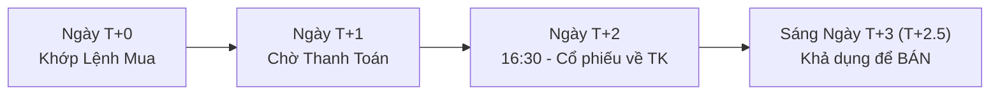

# Quy Tắc Thị Trường Chứng Khoán Việt Nam (VN Market Trading Rules)

**Trạng thái:** tài liệu tham khảo sơ bộ cho market rules; chưa được xác minh theo quy định/venue hiện hành và không phải executable simulator specification. Phải đối chiếu nguồn chính thức, instrument class và ngày hiệu lực trước khi dùng trong backtest/paper.

Không được coi các con số, phiên, phí hoặc settlement details bên dưới là đã duyệt cho mọi instrument/venue. Chúng là checklist nghiên cứu để xác minh và version hóa trước khi triển khai simulator.

---

## 1. Khung Giờ Giao Dịch & Các Phiên Khớp Lệnh

Thị trường chứng khoán Việt Nam hoạt động từ Thứ Hai đến Thứ Sáu (trừ các ngày nghỉ lễ quốc gia). Múi giờ chính thức: `Asia/Ho_Chi_Minh` (UTC+7).

```mermaid
gantt
    title Khung Giờ Giao Dịch Thị Trường Chứng Khoán Cơ Sở Việt Nam
    dateFormat HH:mm
    axisFormat %H:%M

    section Sàn HOSE
    Phiên ATO (Khớp lệnh định kỳ mở cửa)   :09:00, 15m
    Khớp lệnh liên tục phiên Sáng          :09:15, 135m
    Nghỉ trưa                             :11:30, 90m
    Khớp lệnh liên tục phiên Chiều         :13:00, 90m
    Phiên ATC (Khớp lệnh định kỳ đóng cửa) :14:30, 15m
    Giao dịch thỏa thuận                  :14:45, 15m

    section Sàn HNX
    Khớp lệnh liên tục phiên Sáng          :09:00, 150m
    Nghỉ trưa                             :11:30, 90m
    Khớp lệnh liên tục phiên Chiều         :13:00, 90m
    Phiên ATC (Khớp lệnh định kỳ đóng cửa) :14:30, 15m
    Phiên khớp lệnh sau giờ (PLO)          :14:45, 15m
```

### 1.1. Chi Tiết Các Phiên Giao Dịch

| Khung giờ | Phiên | Sàn áp dụng | Đặc điểm khớp lệnh cho Backtest/Paper |
|---|---|---|---|
| **09:00 - 09:15** | **ATO** (At-The-Opening) | HOSE | Khớp lệnh định kỳ xác định giá mở cửa. Không được hủy/sửa lệnh. Lệnh ATO ưu tiên khớp trước lệnh giới hạn (LO). |
| **09:15 - 11:30** | **Khớp lệnh liên tục sáng** | HOSE, HNX, UPCOM | Lệnh được so khớp ngay khi vào hệ thống theo thứ tự: **Ưu tiên về Giá $\rightarrow$ Ưu tiên về Thời gian**. |
| **11:30 - 13:00** | **Nghỉ trưa** | Toàn thị trường | Hệ thống dừng khớp lệnh. Lệnh đặt trong giờ nghỉ trưa nằm ở hàng đợi. |
| **13:00 - 14:30** | **Khớp lệnh liên tục chiều** | HOSE, HNX, UPCOM | Tiếp tục khớp lệnh liên tục. |
| **14:30 - 14:45** | **ATC** (At-The-Closing) | HOSE, HNX | Khớp lệnh định kỳ xác định giá đóng cửa. Không được hủy/sửa lệnh. Lệnh ATC ưu tiên khớp trước lệnh LO. |
| **14:45 - 15:00** | **PLO / Sau giờ** | HNX | Khớp lệnh sau giờ ở mức giá đóng cửa phiên ATC. |

---

## 2. Biên Độ Dao Động Giá (Price Bands)

Giá cổ phiếu trong phiên chỉ được phép dao động trong phạm vi từ **Giá Sàn (Floor)** đến **Giá Trần (Ceiling)**, tính toán dựa trên **Giá Tham Chiếu (Reference Price)** của phiên đó:

$$\text{Giá Trần} = \text{Làm tròn xuống}(\text{Giá Tham Chiếu} \times (1 + \text{Biên Độ}))$$
$$\text{Giá Sàn} = \text{Làm tròn lên}(\text{Giá Tham Chiếu} \times (1 - \text{Biên Độ}))$$

| Sàn Giao Dịch | Biên Độ Dao Động | Cơ Sở Giá Tham Chiếu |
|---|---|---|
| **HOSE** | $\pm 7.0\%$ | Giá đóng cửa (ATC) của ngày giao dịch liền trước. |
| **HNX** | $\pm 10.0\%$ | Giá đóng cửa (ATC) của ngày giao dịch liền trước. |
| **UPCOM** | $\pm 15.0\%$ | **Giá bình quân gia quyền** của tất cả các giao dịch khớp lệnh trong ngày giao dịch liền trước. |
| **Ngày đầu tiên chào sàn** | HOSE: $\pm 20\%$, HNX: $\pm 30\%$, UPCOM: $\pm 40\%$ | Giá dự kiến do tổ chức niêm yết đăng ký. |

*Lưu ý cho Engine mô phỏng:* Mọi lệnh đặt mua cao hơn Giá Trần hoặc đặt bán thấp hơn Giá Sàn đều bị hệ thống từ chối ngay lập tức (Lệnh không hợp lệ).

---

## 3. Bước Giá (Tick Size) & Quy Định Lô Giao Dịch (Lot Size)

### 3.1. Bước Giá (Áp dụng cho sàn HOSE đối với Cổ phiếu & Chứng quyền)

| Khoảng Mức Giá Cổ Phiếu | Bước Giá Tối Thiểu (Tick Size) | Ví dụ mức giá hợp lệ |
|---|---|---|
| **Dưới 10,000 VNĐ** | **10 VNĐ** | 7,120; 7,130; 9,990 VNĐ |
| **10,000 — 49,950 VNĐ** | **50 VNĐ** | 10,050; 24,150; 49,950 VNĐ |
| **Từ 50,000 VNĐ trở lên**| **100 VNĐ** | 50,000; 85,200; 120,500 VNĐ |

- **Sàn HNX & UPCOM:** Áp dụng bước giá đồng nhất là **100 VNĐ** cho mọi mức giá cổ phiếu.

### 3.2. Lô Giao Dịch (Lot Size)
- **Lô Chẵn (Round Lot):** Bội số của **100 cổ phiếu** (tối thiểu 100, 200, ..., tối đa 500,000 cổ phiếu/lệnh). Backtest Engine và Paper Trading mặc định chỉ mô phỏng khớp lệnh lô chẵn.
- **Lô Lẻ (Odd Lot):** Khối lượng từ 1 đến 99 cổ phiếu. Khớp lệnh trên bảng riêng (không ảnh hưởng đến giá tham chiếu hay chỉ số).

---

## 4. Chu Kỳ Thanh Toán & Quản Lý Số Dư (Settlement Cycle T+2.5)

Thị trường chứng khoán cơ sở Việt Nam áp dụng chu kỳ thanh toán bù trừ **T+2.5**:

### 4.1. Quy Tắc Cổ Phiếu Mua Mới (Holdings Availability)
- Khi khớp lệnh Mua vào ngày `T`: Số dư tiền mặt bị trừ ngay lập tức (hoặc phong tỏa). Số lượng cổ phiếu chuyển vào trạng thái `shares_pending_receipt`.
- Sau 16:30 ngày `T+2` (hết giờ giao dịch ngày T+2), cổ phiếu được chuyển sang trạng thái khả dụng `shares_available`.
- **Nhà đầu tư chỉ có thể đặt lệnh Bán cổ phiếu này từ phiên sáng ngày `T+3` (thường được gọi là T+2.5).**
- *Quy tắc Backtest:* Không cho phép bán cổ phiếu vừa mua trong cùng một ngày (Cấm giao dịch T+0 đối với cổ phiếu cơ sở).

### 4.2. Quy Tắc Tiền Bán Cổ Phiếu (Cash Availability)
- Khi khớp lệnh Bán vào ngày `T`: Cổ phiếu bị trừ ngay khỏi số dư khả dụng. Số tiền bán (sau khi trừ thuế và phí) chuyển vào trạng thái `cash_pending_receipt`.
- Tiền bán khả dụng về tài khoản vào chiều ngày `T+2` (hoặc có thể sử dụng dịch vụ ứng trước tiền bán nếu mô phỏng margin).

---

## 5. Thuế Thu Nhập Cá Nhân & Biểu Phí Giao Dịch Mô Phỏng

Để đảm bảo kết quả Backtest và Paper Trading sát thực tế nhất, hệ thống tính toán chi phí theo công thức:

$$\text{Tổng Chi Phí} = \text{Phí Môi Giới Mua} + \text{Phí Môi Giới Bán} + \text{Thuế TNCN Bán}$$

1. **Thuế Thu Nhập Cá Nhân Bán Chứng Khoán (Bắt buộc theo Luật VN):**
   - Áp dụng **0.1%** trên tổng giá trị giao dịch bán (bất kể lãi hay lỗ).
   - $\text{Thuế Bán} = \text{Giá Khớp Bán} \times \text{Khối Lượng Bán} \times 0.001$.
2. **Phí Giao Dịch Môi Giới (Brokerage Fee - Giả lập):**
   - Mặc định cấu hình: **0.10%** đến **0.15%** giá trị giao dịch cho cả chiều Mua và chiều Bán (người dùng có thể tùy chỉnh thông số này trong phần cài đặt Backtest).
3. **Phí Lưu Ký & Thuế Cổ Tức (Mở rộng):**
   - Thuế cổ tức tiền mặt: Khấu trừ 5% tại nguồn khi nhận cổ tức.
   - Cổ phiếu thưởng / Cổ tức cổ phiếu: Nhận thêm cổ phiếu, không trừ tiền ngay, nhưng phải chịu thuế 5% trên mệnh giá khi bán số cổ phiếu này trong tương lai.
