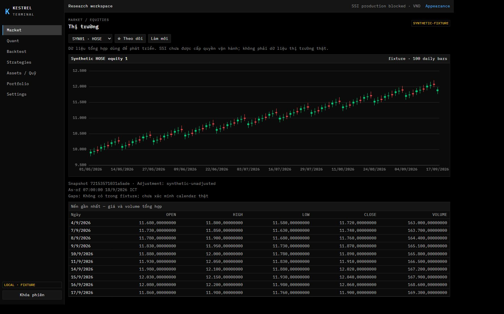
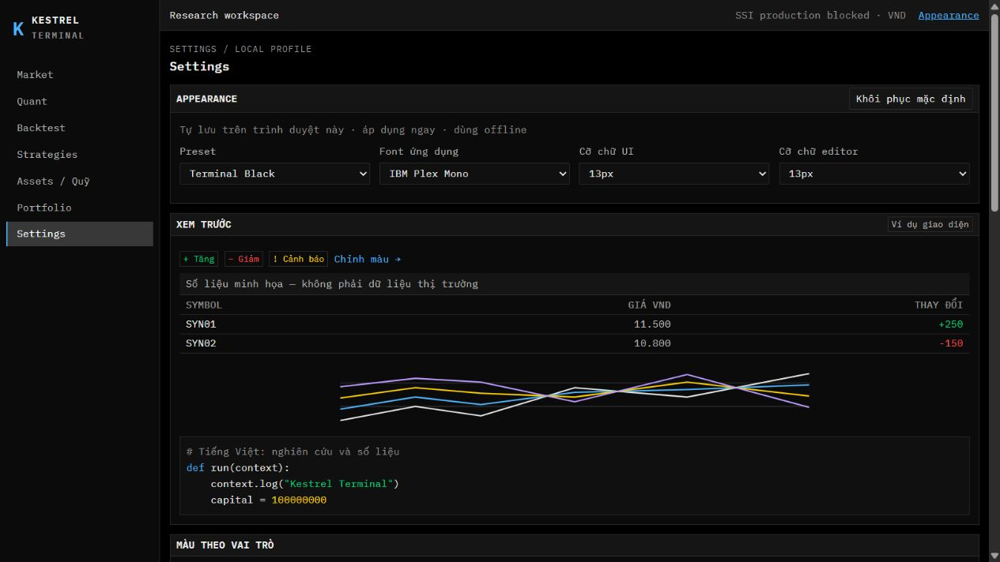

# Terminal UI — Báo cáo bàn giao để review

Ngày 2026-10-20 · triển khai trực tiếp trên **main** · **chưa push**.

## Kết quả

Giữ sidebar, routes, thứ tự nội dung và workspace cây file/editor/kết quả; áp dụng terminal đen, monospace, panel phẳng và bảng cô đọng. Component được đóng gói theo theme/UI/feature; prompt/confirm trình duyệt đã được thay bằng dialog. Appearance cho đổi ba preset tối, 22 vai trò màu, hai font local, cỡ UI/editor và tự lưu tức thì.

Các API và schema backend không đổi. Dữ liệu thị trường, quote replay, paper và backtest vẫn là synthetic fixture; SSI live và lệnh thật vẫn bị khóa.

## Mở và xem

Preview đang dùng production build qua [gateway local](http://127.0.0.1:8080/settings#appearance). Tab Appearance được để lại để xem. Runtime review ban đầu dùng `.cache/ui-redesign-review`; khi ổ D đầy, chỉ build và profile do lượt này tạo ra được chuyển sang vùng artifact được phép trên ổ C (`kestrel-ui-review/dist` và `kestrel-ui-review/profile`). Runtime phục vụ build đó qua `KESTREL_WEB_DIST`; profile mặc định của chủ dự án không thay đổi. Các quỹ và giao dịch trong ảnh là dữ liệu minh họa được tạo riêng cho kiểm thử.

Trong Settings → Appearance, thử preset, font, cỡ chữ và màu HEX. Tùy chỉnh áp dụng và lưu ngay; HEX chưa đủ ký tự chỉ nằm ở ô nhập. Khôi phục mặc định có xác nhận. Preference chỉ thuộc trình duyệt hiện tại, không được lưu vào sổ quỹ hoặc backend.

Để chạy bản local, dùng Docker Compose như hướng dẫn trong README. Khi cần debug từng dịch vụ, dùng workflow ba terminal tại README; không dùng profile review để lưu dữ liệu thật.

## Ảnh để review

- [Market desktop](review-assets/market-desktop.jpg)
- [Appearance và typography](review-assets/appearance-preview.jpg)
- [Các nhóm màu theo vai trò](review-assets/appearance-colors.jpg)
- [Backtest desktop](review-assets/backtest-desktop.jpg)
- [Backtest tablet](review-assets/backtest-tablet.jpg)
- [Portfolio có nguồn định giá](review-assets/portfolio-desktop.jpg)

## Kiểm tra thực hiện

| Kiểm tra | Kết quả |
|---|---|
| `npm run typecheck` | Qua; production build cũng chạy `tsc --noEmit` |
| `npm run lint` | Qua |
| `npm run test:web` | 35 test / 15 file qua |
| `npm run build` | Qua; vẫn có cảnh báo bundle lớn của Monaco/Plotly |
| `node scripts/check-docs.mjs` | Qua — 68 file Markdown, đường dẫn và heading |
| Native prompt/confirm và mã theme sáng cũ | Đã loại khỏi frontend runtime |

Regression bao phủ preference hỏng/phiên bản cũ, storage không khả dụng, đồng bộ tab, preset contrast, HEX nhập dở, reset có xác nhận, dialog pending/lỗi/focus, quỹ nhận cùng loại, giữ số tiền khi lỗi, buffer khi đổi file, phím tắt lưu, Stop đang stopping, SSE reconnect/duplicate/cũ, pane bounds, giữ chart view khi đổi màu, queued resize lúc unmount và lỗi tải editor.

Browser review đã thực hiện trên gateway/engine thật với profile fixture riêng:

- Đăng nhập, Market candle và các màn chính; kiểm tra 35 tổ hợp gồm bảy màn × năm viewport yêu cầu 1920×1080, 1440×900, 1280×800, 1024×768 và 768×1024. Không thấy tràn ngang toàn trang; bảng/pane cuộn trong vùng riêng. CSS viewport thực tế được đo cùng `window.innerWidth` vì embedded browser có thể áp dụng zoom.
- Font IBM Plex Mono và JetBrains Mono; cỡ UI 12/13/14px; HEX lỗi → hợp lệ, đổi màu/font, reload giữ preference và reset trở lại Terminal Black.
- Resize file pane bằng phím tăng/giảm 8px; xem workspace ở desktop/tablet.
- Tạo file Backtest bằng dialog; Lưu và Run bằng shortcut; Train và Test dùng Train đóng băng đều completed. So sánh A/B hiển thị stage, metrics và provenance; Sharpe chưa khả dụng được ghi đúng lý do.
- Research template completed, hiển thị log, bảng, biểu đồ và artifact. Strategy giữ SSI blocked, chỉ chạy sau khi chọn rõ fixture replay và allocation; template completed.
- Seed riêng ba quỹ, hai allocation và một tracking trade; thử dialog nạp `25.50`, nhận số dư `80.000.025,5` từ backend; dialog chuyển vốn chỉ có quỹ nhận cùng loại.
- Manual Paper yêu cầu acknowledgment; advance quote, đặt lệnh buy fixture, advance tiếp chuyển open → filled. Portfolio hiển thị vị thế, nguồn mark, thời gian và P&L cập nhật.

Loading/error/empty và các lỗi khó tái hiện như SSE/storage/lazy-load được kiểm tra bằng component tests; không giả định đã ép từng lỗi API trên từng màn ở browser.

## Giới hạn và ghi chú review

- Chưa có audit screen reader toàn diện, pixel regression baseline, full mobile layout hay kiểm tra mọi browser/OS. Không chạy lại toàn bộ Go/Python unit suite vì thay đổi thuộc frontend; các API thực được dùng trong các luồng fixture nêu trên.
- Bundle Monaco khoảng 2.7 MB và Plotly khoảng 1.16 MB trước gzip vẫn lớn và được tải lazy.
- Vite dev optimizer và lần ghi commit tài liệu cuối gặp thiếu dung lượng trên ổ D. Nghiệm thu sử dụng production build/gateway; build/profile review đã được chuyển sang artifact ổ C để giải phóng chỗ ghi commit. Không xóa cache hay dữ liệu khác của người dùng.
- Tab cũ đang mở trong lúc build lại đã gặp chunk editor không còn tồn tại. Đã thêm EditorBoundary để lỗi tải editor không làm trắng cả app; reload vẫn tuân theo cảnh báo buffer chưa lưu của trình duyệt.
- Đã phát hiện và sửa race ResizeObserver gọi Plotly sau unmount/trước khi plot sẵn sàng; có regression riêng. Reload build cuối, mở Quant chart rồi rời sang Appearance không tạo thêm console error.
- Có một ngoại lệ lịch sử: `3e221dc` có lỗi cú pháp trung gian và được sửa ngay ở `997ae8d`. Giữ cả hai commit theo yêu cầu không amend/rewrite; review cặp này cùng nhau. HEAD cuối đã qua các kiểm tra ghi trên.
- Mỗi dòng commit dưới có mục đích riêng. Cột kiểm tra mô tả coverage liên quan và kiểm tra ở HEAD cuối, không khẳng định đã chạy toàn suite tại mọi commit.

## Lịch sử commit để review

Baseline: `96c3c15`. Các commit triển khai/sửa review bên dưới, cộng commit tài liệu bàn giao này; không squash/amend và không push. Tra hash của commit bàn giao bằng `git log -1`.

| # | Commit | Task / thay đổi | Kiểm tra liên quan |
|---|---|---|---|
| 01 | `e9b0776` | docs(ui): record terminal redesign and local review workflow | Kiểm tra Markdown |
| 02 | `90b6413` | feat(theme): define terminal palettes and semantic color roles | Typecheck / build ở HEAD cuối |
| 03 | `6319797` | feat(theme): validate versioned appearance preferences | Có regression kèm commit; suite cuối |
| 04 | `e9bb380` | feat(fonts): bundle licensed Vietnamese monospace webfonts | Build WOFF2 / giấy phép; kiểm font UI |
| 05 | `3715aa7` | feat(theme): persist and synchronize live appearance preferences | Có regression kèm commit; suite cuối |
| 06 | `f1daaa3` | feat(ui): add compact page panel and toolbar primitives | Typecheck / build ở HEAD cuối |
| 07 | `f5d9fc7` | feat(ui): add pending buttons icon controls and tooltips | Typecheck / build ở HEAD cuối |
| 08 | `6287f71` | feat(ui): add accessible compact form fields | Typecheck / build ở HEAD cuối |
| 09 | `35d6cfd` | feat(ui): add semantic tables exact decimals and status labels | Typecheck / build ở HEAD cuối |
| 10 | `4111186` | feat(ui): distinguish loading empty error and success feedback | Typecheck / build ở HEAD cuối |
| 11 | `41b0f3c` | feat(ui): add focused async dialogs and pending safeguards | Có regression kèm commit; suite cuối |
| 12 | `b9b2d26` | feat(appearance): add preset and monospace typography controls | Typecheck / build ở HEAD cuối |
| 13 | `6490eac` | feat(appearance): edit semantic colors with reset and contrast feedback | Typecheck / build ở HEAD cuối |
| 14 | `2bc2040` | feat(appearance): preview tables charts code and confirm reset | Typecheck / build ở HEAD cuối |
| 15 | `36d182a` | feat(settings): integrate autosaved appearance before source evidence | Typecheck / build ở HEAD cuối |
| 16 | `ac43637` | feat(shell): apply flat terminal styling and appearance navigation | Typecheck / build ở HEAD cuối |
| 17 | `9a1a837` | feat(auth-ui): distinguish session loading login and gateway failure | Typecheck / build ở HEAD cuối |
| 18 | `fd5b89e` | feat(charts): theme candlesticks without recreating the chart | Typecheck / build ở HEAD cuối |
| 19 | `e9edba2` | feat(charts): preserve Plotly view while updating appearance | Typecheck / build ở HEAD cuối |
| 20 | `171552b` | feat(editor): apply semantic theme and retain per-file view state | Typecheck / build ở HEAD cuối |
| 21 | `b9348bb` | refactor(market): use terminal panels and explicit snapshot states | Typecheck / build ở HEAD cuối |
| 22 | `23636e2` | refactor(quant): standardize controls and expose catalog failures | Typecheck / build ở HEAD cuối |
| 23 | `61122e0` | refactor(assets): package fund and allocation forms with pending feedback | Typecheck / build ở HEAD cuối |
| 24 | `d08b4b7` | feat(assets): replace deposit and withdrawal prompts with dialogs | Typecheck / build ở HEAD cuối |
| 25 | `d1a4621` | feat(assets): select compatible funds in transfer and release dialogs | Typecheck / build ở HEAD cuối |
| 26 | `4d98a83` | refactor(assets): package allocation table and reconciliation confirmation | Typecheck / build ở HEAD cuối |
| 27 | `7e4d817` | refactor(paper): standardize replay controls orders and pending states | Typecheck / build ở HEAD cuối |
| 28 | `430e710` | refactor(portfolio): render exact NAV positions and price provenance | Typecheck / build ở HEAD cuối |
| 29 | `184331c` | refactor(portfolio): package settled trade form and submission feedback | Typecheck / build ở HEAD cuối |
| 30 | `12b5726` | refactor(portfolio): present CSV preview as an accessible table | Typecheck / build ở HEAD cuối |
| 31 | `060db3e` | refactor(settings): package source evidence and local profile guidance | Typecheck / build ở HEAD cuối |
| 32 | `df9fb6c` | refactor(workspace): extract semantic sidebar file tree | Typecheck / build ở HEAD cuối |
| 33 | `4f976b3` | refactor(workspace): extract toolbar and dirty buffer presentation | Typecheck / build ở HEAD cuối |
| 34 | `1372e9a` | refactor(workspace): scope history and structured output to selected run | Typecheck / build ở HEAD cuối |
| 35 | `dcb5ceb` | feat(workspace): replace file prompts with validated async dialogs | Typecheck / build ở HEAD cuối |
| 36 | `d3b7a83` | fix(workspace): gate run actions and surface file and job states | Typecheck / build ở HEAD cuối |
| 37 | `1273911` | fix(workspace): isolate SSE reconnect state from job failures | Có regression kèm commit; suite cuối |
| 38 | `3e221dc` | feat(workspace): add scoped shortcuts and keyboard file navigation | Lỗi cú pháp trung gian; đọc cùng 997ae8d |
| 39 | `997ae8d` | fix(workspace): close shortcut capture expression correctly | Sửa ngay commit trước; typecheck qua |
| 40 | `9de321e` | feat(workspace): persist bounded panes with pointer and keyboard resize | Có regression kèm commit; suite cuối |
| 41 | `37e80e6` | feat(backtest-ui): validate dates and freeze selected Train configuration | Có regression kèm commit; suite cuối |
| 42 | `d3bf517` | refactor(backtest): standardize report comparison and provenance states | Typecheck / build ở HEAD cuối |
| 43 | `5d055d6` | feat(strategy-ui): expose source gates and allocation readiness | Typecheck / build ở HEAD cuối |
| 44 | `46413cb` | fix(responsive): contain controls and scrolling within tablet panels | Typecheck / build ở HEAD cuối |
| 45 | `730fa8e` | fix(a11y): restore route focus and cover appearance dialog and buffer flows | Có regression kèm commit; suite cuối |
| 46 | `899e06e` | fix(charts): wait for bundled fonts and cover live appearance preservation | Build WOFF2 / giấy phép; kiểm font UI |
| 47 | `01ea3e2` | fix(tables): distinguish initial loading from empty ledger data | Typecheck / build ở HEAD cuối |
| 48 | `e520acc` | fix(a11y): retain a file tree tab stop after rename or removal | Có regression kèm commit; suite cuối |
| 49 | `1fa3ead` | fix(editor): derive syntax and completion surfaces from semantic roles | Typecheck / build ở HEAD cuối |
| 50 | `fe6972c` | fix(workspace): honor stopping state before the next stream event | Có regression kèm commit; suite cuối |
| 51 | `8652aeb` | fix(typography): wrap long fund identifiers and scale run output text | Typecheck / build ở HEAD cuối |
| 52 | `64da49a` | test(workspace): capture fake streams without this aliasing | Có regression kèm commit; suite cuối |
| 53 | `9f63610` | fix(editor): contain lazy-load failures within the workspace pane | Có regression kèm commit; suite cuối |
| 54 | `414ea6a` | fix(charts): ignore queued resize after plot unmount or before readiness | Có regression kèm commit; suite cuối |

Sau review, các sửa đổi tiếp theo sẽ là commit bổ sung. Chỉ push khi chủ dự án yêu cầu rõ.
