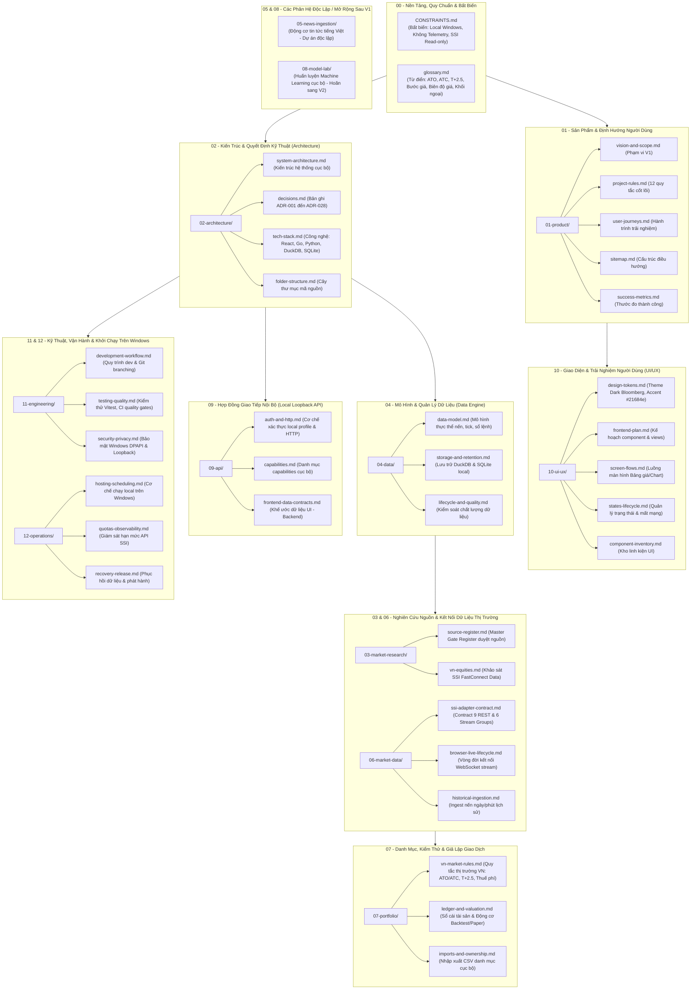

# Research Terminal — Documentation Hub

**Trạng thái:** Kiến trúc mục tiêu **Lớp 2 (Local-first Bloomberg Terminal cho TTCK Việt Nam)**.  
Ứng dụng mã nguồn mở, chạy hoàn toàn cục bộ trên máy trạm Windows của nhà đầu tư cá nhân, kết nối trực tiếp đến dữ liệu chứng khoán cơ sở Việt Nam (HOSE, HNX, UPCOM) qua **SSI FastConnect Data**.

---

## 1. Bản Đồ Cấu Trúc Toàn Diện Bộ Tài Liệu (Comprehensive Documentation Map)

Sơ đồ dưới đây bao quát toàn diện **tất cả 12 thư mục chức năng từ `01` đến `12`**, các file quy định nền tảng và các phân hệ dữ liệu/kỹ thuật của dự án:

---

## 2. Hướng Dẫn Đọc Theo Vai Trò (Reading Guide)

### Dành cho Lập trình viên Backend & Dữ liệu:
1. Đọc kỹ các bất biến trong [CONSTRAINTS.md](CONSTRAINTS.md) (không lưu plain secrets, không telemetry, loopback only).
2. Nắm rõ các quyết định kỹ thuật cốt lõi tại [02-architecture/decisions.md](02-architecture/decisions.md) (ADR-026: DuckDB/SQLite, ADR-027: Launcher, ADR-028: Windows DPAPI Vault).
3. Đọc đặc tả kết nối [06-market-data/ssi-adapter-contract.md](06-market-data/ssi-adapter-contract.md) và [06-market-data/browser-live-lifecycle.md](06-market-data/browser-live-lifecycle.md).
4. Xem mô hình thực thể tại [04-data/data-model.md](04-data/data-model.md) và khế ước API tại [09-api/frontend-data-contracts.md](09-api/frontend-data-contracts.md).
5. Tham chiếu thuật ngữ chứng khoán tại [glossary.md](glossary.md).

### Dành cho Lập trình viên Frontend & UI/UX:
1. Nắm bắt bản đồ điều hướng và luồng màn hình tại [01-product/sitemap.md](01-product/sitemap.md) và [10-ui-ux/screen-flows.md](10-ui-ux/screen-flows.md).
2. Xem bảng mã màu Design Tokens (Theme Dark, Accent `#21684e`) tại [10-ui-ux/design-tokens.md](10-ui-ux/design-tokens.md).
3. Đọc trạng thái tải, mất mạng và phục hồi luồng dữ liệu tại [10-ui-ux/states-lifecycle.md](10-ui-ux/states-lifecycle.md).
4. Tham khảo kế hoạch xây dựng linh kiện tại [10-ui-ux/frontend-plan.md](10-ui-ux/frontend-plan.md).

### Dành cho Chuyên gia Định lượng (Quant) & Thiết kế Chiến lược:
1. Đọc [07-portfolio/vn-market-rules.md](07-portfolio/vn-market-rules.md) để nắm toàn bộ luật khớp lệnh thực tế của TTCK Việt Nam (phiên ATO/ATC, biên độ, bước giá, chu kỳ T+2.5, thuế phí).
2. Đọc [07-portfolio/ledger-and-valuation.md](07-portfolio/ledger-and-valuation.md) về cơ chế tính toán P&L, quản lý số dư tiền/cổ phiếu, và các kiểm soát chống Lookahead Bias.

---

## 3. Bản Đồ Tham Chiếu Nhanh Tất Cả Các Module (Reference Matrix)

| Thư mục / Tài liệu | Mục đích chính | File quan trọng nhất |
|---|---|---|
| **[CONSTRAINTS.md](CONSTRAINTS.md)** | Bất biến kỹ thuật: Local-first, SSI-only, Read-only, Bảo mật | Toàn bộ file |
| **[glossary.md](glossary.md)** | Từ điển thuật ngữ TTCK Việt Nam và hệ thống | Toàn bộ file |
| **`01-product/`** | Định nghĩa phạm vi sản phẩm, hành trình người dùng và thước đo | [vision-and-scope.md](01-product/vision-and-scope.md), [project-rules.md](01-product/project-rules.md) |
| **`02-architecture/`** | Kiến trúc hệ thống, cấu trúc thư mục, các bản ghi quyết định ADR | [decisions.md](02-architecture/decisions.md), [system-architecture.md](02-architecture/system-architecture.md) |
| **`03-market-research/`**| Bằng chứng pháp lý, nghiên cứu thị trường, Master Gate Register | [vn-equities.md](03-market-research/vn-equities.md), [source-register.md](03-market-research/source-register.md) |
| **`04-data/`** | Mô hình thực thể nến, tick, bảng giá, snapshot và retention | [data-model.md](04-data/data-model.md), [storage-and-retention.md](04-data/storage-and-retention.md) |
| **`05-news-ingestion/`** | Nghiên cứu động cơ tin tức tiếng Việt (tách thành phân hệ độc lập) | [README.md](05-news-ingestion/README.md) |
| **`06-market-data/`** | Contract kỹ thuật SSI FastConnect Data & cơ chế streaming local | [ssi-adapter-contract.md](06-market-data/ssi-adapter-contract.md), [browser-live-lifecycle.md](06-market-data/browser-live-lifecycle.md) |
| **`07-portfolio/`** | Luật khớp lệnh VN, kiểm thử chiến lược (Backtest) & Paper Trading | [vn-market-rules.md](07-portfolio/vn-market-rules.md), [ledger-and-valuation.md](07-portfolio/ledger-and-valuation.md) |
| **`08-model-lab/`** | Phân hệ nghiên cứu mô hình máy học (Hoãn sang V2) | [README.md](08-model-lab/README.md) |
| **`09-api/`** | Hợp đồng giao tiếp nội bộ giữa UI React và Go/Python local services | [auth-and-http.md](09-api/auth-and-http.md), [capabilities.md](09-api/capabilities.md) |
| **`10-ui-ux/`** | Bloomberg Terminal design tokens, bảng giá, biểu đồ, phím tắt | [design-tokens.md](10-ui-ux/design-tokens.md), [frontend-plan.md](10-ui-ux/frontend-plan.md) |
| **`11-engineering/`** | Quy trình phát triển, kiểm thử chất lượng, CI/CD, Agent rules | [development-workflow.md](11-engineering/development-workflow.md), [security-privacy.md](11-engineering/security-privacy.md) |
| **`12-operations/`** | Cẩm nang cài đặt Windows, cơ chế mã hóa Secret Vault, Launcher | [hosting-scheduling.md](12-operations/hosting-scheduling.md), [quotas-observability.md](12-operations/quotas-observability.md) |
| **`_archive/`** | Tài liệu lưu trữ các hướng nghiên cứu cũ (Crypto/Binance, US, FX, Model Lab cũ) | Lưu trữ tham khảo lịch sử |

---

## 4. Nguồn Sự Thật & Trọng Tâm Phát Triển (Source of Truth)

- **Phạm vi sản phẩm V1:** [01-product/vision-and-scope.md](01-product/vision-and-scope.md) và [CONSTRAINTS.md](CONSTRAINTS.md) là tài liệu cao nhất định đoạt tính năng nào được làm và tính năng nào bị loại bỏ.
- **Tiến độ và các bước thực hiện tiếp theo:** Được theo dõi thống nhất tại [task/next-plan.md](../task/next-plan.md).
- **Trạng thái cổng kết nối (Source Gate):** [03-market-research/source-register.md](03-market-research/source-register.md) nắm quyền quản lý duy nhất trạng thái duyệt nguồn của SSI FastConnect Data.
