# Research Terminal — Documentation Hub

**Trạng thái:** Kiến trúc mục tiêu **Lớp 2 (Local-first Bloomberg Terminal cho TTCK Việt Nam)**.  
Ứng dụng mã nguồn mở, chạy hoàn toàn cục bộ trên máy trạm Windows của nhà đầu tư cá nhân, kết nối trực tiếp đến dữ liệu chứng khoán cơ sở Việt Nam (HOSE, HNX, UPCOM) qua **SSI FastConnect Data**.

---

## 1. Bản Đồ Cấu Trúc Tài Liệu (Functional Block Matrix)

Tài liệu được phân định thành **4 Khối chức năng cốt lõi** và **1 Khối nghiên cứu mở rộng**, tối giản liên kết chéo để mang lại cái nhìn trực quan, phân tách ranh giới rõ ràng:

```mermaid
graph TB
    %% Khối 1: Core Governance & Invariants
    subgraph Block1 ["🏛️ KHỐI 1: QUY CHUẨN NỀN TẢNG & SẢN PHẨM (CORE & PRODUCT)"]
        direction TB
        B1_1["<b>Bất Biến Kỹ Thuật</b><br/>• CONSTRAINTS.md (Local-first, Không Telemetry, SSI Read-only)<br/>• glossary.md (Từ điển TTCK VN: ATO, ATC, T+2.5, Bước giá)"]
        B1_2["<b>Định Hướng Sản Phẩm (01-product/)</b><br/>• vision-and-scope.md (Phạm vi Terminal V1)<br/>• project-rules.md (12 quy tắc bất biến)<br/>• user-journeys.md & sitemap.md (Trải nghiệm & Điều hướng)"]
        B1_1 --- B1_2
    end

    %% Khối 2: Market Data Pipeline
    subgraph Block2 ["📈 KHỐI 2: DỮ LIỆU THỊ TRƯỜNG VIỆT NAM (MARKET DATA PIPELINE)"]
        direction TB
        B2_1["<b>Khảo Sát & Duyệt Nguồn (03-market-research/)</b><br/>• source-register.md (Master Gate Register: SSI documented/approved)<br/>• vn-equities.md (Khảo sát các endpoints & quyền dữ liệu SSI)"]
        B2_2["<b>Hợp Đồng Kết Nối SSI (06-market-data/)</b><br/>• ssi-adapter-contract.md (Chi tiết 9 REST & 6 SignalR Stream Groups)<br/>• browser-live-lifecycle.md (Quản lý kết nối WebSocket, Reconnect & Backfill)<br/>• historical-ingestion.md (Quy chuẩn nến ngày & intraday lịch sử)"]
        B2_1 --- B2_2
    end

    %% Khối 3: Quant, Portfolio & Simulator
    subgraph Block3 ["📊 KHỐI 3: DANH MỤC & ĐỘNG CƠ ĐỊNH LƯỢNG (QUANT & SIMULATOR)"]
        direction TB
        B3_1["<b>Quy Tắc Khớp Lệnh VN (07-portfolio/)</b><br/>• vn-market-rules.md (Khung giờ ATO/ATC, Biên độ trần sàn, Bước giá, T+2.5, Thuế 0.1%)"]
        B3_2["<b>Động Cơ Định Giá & Mô Phỏng</b><br/>• ledger-and-valuation.md (Sổ cái tài sản, Backtest Engine, Paper Live Trading)<br/>• imports-and-ownership.md (Nhập xuất CSV danh mục cục bộ)"]
        B3_1 --- B3_2
    end

    %% Khối 4: Desktop Architecture & Operations
    subgraph Block4 ["💻 KHỐI 4: KIẾN TRÚC & VẬN HÀNH WINDOWS (DESKTOP & OPERATIONS)"]
        direction TB
        B4_1["<b>Kiến Trúc & Quyết Định (02-architecture/ & 04-data/)</b><br/>• decisions.md (Bản ghi ADR-001 đến ADR-028)<br/>• RT-ADR-026 (DuckDB cho Nến/Tick + SQLite cho Sổ cái Danh mục)<br/>• data-model.md & storage-and-retention.md (Mô hình thực thể local)"]
        B4_2["<b>Giao Diện Bloomberg & Bảo Mật (10-ui-ux/, 09-api/, 11- & 12-)</b><br/>• design-tokens.md (Dark Terminal Theme, Accent #21684e)<br/>• RT-ADR-028 & security-privacy.md (Bảo vệ SSI Secret bằng Windows DPAPI)<br/>• RT-ADR-027 & hosting-scheduling.md (Launcher 1 lệnh trên Windows)"]
        B4_1 --- B4_2
    end

    %% Khối 5: Phân hệ độc lập
    subgraph Block5 ["🔬 KHỐI 5: PHÂN HỆ ĐỘC LẬP & MỞ RỘNG SAU V1 (STANDALONE / DEFERRED)"]
        direction TB
        B5_1["• 05-news-ingestion/ : Động cơ tin tức tài chính tiếng Việt (Xây dựng độc lập)<br/>• 08-model-lab/ : Huấn luyện mô hình Machine Learning cục bộ (Hoãn sang V2)<br/>• _archive/ : Lưu trữ tài liệu lịch sử Crypto/Binance, US Equities, Forex"]
    end

    Block1 ==> Block2
    Block2 ==> Block3
    Block3 ==> Block4
    Block4 -.-> Block5
```

---

## 2. Hướng Dẫn Đọc Theo Nhu Cầu Thực Tế (Reading Guide)

### 1. Nếu bạn cần phát triển Kết nối Dữ liệu (Market Data & Feed):
- Bắt đầu từ [CONSTRAINTS.md](CONSTRAINTS.md) (Nắm nguyên tắc Read-Only, không lưu credential trên browser).
- Đọc [06-market-data/ssi-adapter-contract.md](06-market-data/ssi-adapter-contract.md) để nắm cấu trúc 9 REST APIs và 6 SignalR Streams.
- Xem [06-market-data/browser-live-lifecycle.md](06-market-data/browser-live-lifecycle.md) để xử lý cơ chế reconnect và backfill nến.

### 2. Nếu bạn cần phát triển Giao diện Terminal (UI/UX Frontend):
- Xem cấu trúc màn hình tại [01-product/sitemap.md](01-product/sitemap.md) và [10-ui-ux/screen-flows.md](10-ui-ux/screen-flows.md).
- Tuân thủ bảng mã màu chuẩn Bloomberg (Màu chủ đạo Dark, Accent `#21684e`) tại [10-ui-ux/design-tokens.md](10-ui-ux/design-tokens.md).
- Xem trạng thái hiển thị mất mạng / stale data tại [10-ui-ux/states-lifecycle.md](10-ui-ux/states-lifecycle.md).

### 3. Nếu bạn cần phát triển Động cơ Backtest & Giả lập (Quant & Simulator):
- Đọc bắt buộc: [07-portfolio/vn-market-rules.md](07-portfolio/vn-market-rules.md) (Toàn bộ luật khớp lệnh ATO/ATC, biên độ, bước giá, thanh toán T+2.5, thuế bán 0.1%).
- Đọc [07-portfolio/ledger-and-valuation.md](07-portfolio/ledger-and-valuation.md) để thiết kế thuật toán chống Lookahead Bias và định giá tài sản.

### 4. Nếu bạn cần cấu hình Hệ thống Cục bộ & Bảo mật (Desktop Engine & Security):
- Xem kiến trúc lưu trữ lai (DuckDB + SQLite) tại [02-architecture/decisions.md](02-architecture/decisions.md) (RT-ADR-026).
- Xem cơ chế bảo mật khóa bí mật qua Windows DPAPI tại [11-engineering/security-privacy.md](11-engineering/security-privacy.md) (RT-ADR-028).
- Xem cơ chế khởi chạy 1 lệnh trên Windows tại [12-operations/hosting-scheduling.md](12-operations/hosting-scheduling.md) (RT-ADR-027).

---

## 3. Bản Đồ Tham Chiếu Nhanh Tất Cả Các Module (Reference Matrix)

| Khối Chức Năng | Thư mục / File | Mục đích chính |
|---|---|---|
| **🏛️ Nền tảng & Sản phẩm** | **[CONSTRAINTS.md](CONSTRAINTS.md)** **[glossary.md](glossary.md)** `01-product/` | Quy chuẩn bất biến local-first, bảo mật, từ điển chứng khoán Việt Nam, phạm vi và quy tắc sản phẩm. |
| **📈 Dữ liệu thị trường** | `03-market-research/` `06-market-data/` | Quản lý cổng duyệt nguồn (Source Gate), contract 9 REST & 6 Streams của SSI FastConnect Data, ingest lịch sử. |
| **📊 Định lượng & Danh mục** | `07-portfolio/` | Luật giao dịch cơ sở VN (ATO/ATC, T+2.5), động cơ Backtest không Lookahead Bias, Paper Trading Simulator. |
| **💻 Kiến trúc & Desktop Ops** | `02-architecture/` `04-data/` `09-api/` `10-ui-ux/` `11-engineering/` `12-operations/` | Quyết định kỹ thuật ADR-001 đến 028, DuckDB/SQLite local, bảo mật Windows DPAPI, Bloomberg dark theme, Launcher. |
| **🔬 Độc lập & Mở rộng** | `05-news-ingestion/` `08-model-lab/` `_archive/` | Động cơ tin tức tiếng Việt độc lập, Model Lab máy học hoãn sang V2, kho lưu trữ lịch sử nghiên cứu cũ. |

---

## 4. Nguồn Sự Thật & Trọng Tâm Phát Triển (Source of Truth)

- **Phạm vi sản phẩm V1:** [01-product/vision-and-scope.md](01-product/vision-and-scope.md) và [CONSTRAINTS.md](CONSTRAINTS.md) là tài liệu cao nhất định đoạt tính năng nào được làm và tính năng nào bị loại bỏ.
- **Tiến độ và các bước thực hiện tiếp theo:** Được theo dõi thống nhất tại [task/next-plan.md](../task/next-plan.md).
- **Trạng thái cổng kết nối (Source Gate):** [03-market-research/source-register.md](03-market-research/source-register.md) nắm quyền quản lý duy nhất trạng thái duyệt nguồn của SSI FastConnect Data.
